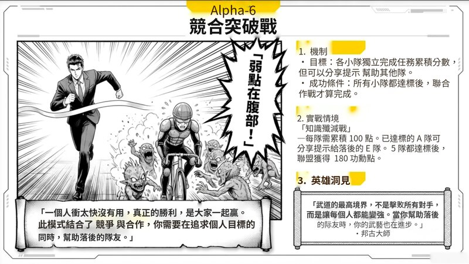
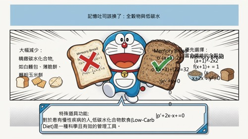

# NBLM2PPTX - Convertidor de PDF de NotebookLM a PPTX

[](https://opensource.org/licenses/MIT)
[](https://github.com/laihenyi/NBLM2PPTX/stargazers)
[](https://github.com/laihenyi/NBLM2PPTX/network/members)
[](https://github.com/laihenyi/NBLM2PPTX/issues)

Convierte PDFs exportados de NotebookLM en presentaciones PPTX con **imágenes de fondo y capas de texto editables separadas**.

> ✨ **Actualización (2026-10-21)**: App nativa para macOS (n2p-rs) v0.1.1: convierte PDF en PPTX editable en tu Mac, sin clave de API y notarizada por Apple. Consulta «App nativa para macOS» más abajo.

[English](README.md) | [繁體中文](README-zh-TW.md) | [简体中文](README-zh-CN.md) | [日本語](README-ja.md) | [Français](README-fr.md)

## App nativa para macOS (sin conexión, Rust)

[`n2p-rs/`](n2p-rs/) es una versión nativa que se ejecuta por completo en tu Mac: sin clave de API y sin subir ningún archivo.

- **Descarga**: [página de la versión](https://github.com/laihenyi/NBLM2PPTX/releases/tag/n2p-rs-v0.1.1) (`NotebookLM2PPT-notarized.zip`)
- **OCR**: Vision integrado en macOS (en el dispositivo)
- **Eliminación de texto**: borra solo los trazos del texto; los fondos con textura se reconstruyen con LaMa en la GPU (CoreML)
- **Extracción de objetos (experimental)**: iconos e ilustraciones pasan a ser imágenes movibles (MobileSAM)
- **App**: interfaz de arrastrar y soltar, firmada con Developer ID y notarizada por Apple; los modelos (~253 MB) se descargan en el primer uso
- **Requisitos**: Apple Silicon; macOS 12 o posterior para la inferencia en GPU

Compilación, uso por línea de comandos y notas de diseño: [`n2p-rs/README.md`](n2p-rs/README.md). Licencias de terceros: [`n2p-rs/THIRD-PARTY.md`](n2p-rs/THIRD-PARTY.md).

### Antes y después (versión estándar)

| Original (PDF de NotebookLM) | Resultado (PPTX editable, app para macOS) |
|:---:|:---:|
|  |  |
|  |  |

> El texto se convierte en cuadros de texto editables; las ilustraciones quedan en el fondo y se elimina la marca de agua de NotebookLM (resultado renderizado con LibreOffice).
> Limitaciones actuales visibles aquí: no se conservan los colores de resaltado, a veces se pierde la negrita y el OCR puede leer mal algunos caracteres.

### v0.1.1 (2026-10-21)

- **Versión con objetos unas 2 veces más rápida y pico de memoria de ~6 GB a ~1,9 GB**: SAM ahora se ejecuta solo en la CPU (presentación de 11 páginas: 47–86 s, antes 103–183 s)
- El texto de varias líneas se alinea a la izquierda cuando así está en el original (antes siempre se centraba)
- Dilatación de máscaras más rápida en la extracción de objetos
- Interfaz: la sección de modelos indica si la versión GPU de LaMa está lista
- Herramientas de desarrollo: la comprobación de compatibilidad con PowerPoint solo lee y cierra la presentación que abrió ella misma

### v0.1.0 (2026-10-21)

- Primera versión: app de arrastrar y soltar, firmada y notarizada
- Velocidad (Apple Silicon, presentación de 11 páginas): versión estándar 29–45 s (~1,1–1,4 GB), versión con objetos 103–183 s (~6 GB)

## Versión web asistida por Gemini (ya no se actualiza)

> ⚠️ Todo lo que sigue describe la versión web asistida por Gemini (`index.html`). **Ya no se actualiza**; el desarrollo nuevo se hace en la app nativa para macOS de arriba.

## Demostración

### v1.1 - Extracción de Texto Híbrida

| Original (NotebookLM PDF) | Salida (PPTX Editable) |
|:-------------------------:|:----------------------:|
|  |  |

> La extracción nativa de texto PDF.js proporciona posicionamiento preciso del texto sin llamadas API adicionales.

### v1.0 - Eliminación de Texto con IA

| Antes (NotebookLM PDF) | Después (PPTX Editable) |
|:----------------------:|:-----------------------:|
|  |  |

> Izquierda: PDF original de NotebookLM (texto incrustado en imagen)
> Derecha: PPTX convertido con fondo limpio + capas de texto editables

## Novedades en v2.3 (2026-01-21)

### ⚡ Sistema OCR de Modo Dual
- **Modelo Lite (Predeterminado)**: Usa `gemini-2.5-flash-lite` para OCR, 40-50% más rápido con 50% de ahorro de cuota API
- **Modelo Estándar (Opcional)**: Usa `gemini-2.5-flash` para detección completa de tamaño de fuente, peso y estilo de color
- **Flexibilidad del Usuario**: Cambia modelos OCR durante la selección de páginas para equilibrar velocidad y calidad según tus necesidades

### 🚀 Tecnología de Procesamiento Paralelo
- **Ejecución Simultánea**: La eliminación de texto y el OCR se ejecutan simultáneamente, sin espera
- **Tiempo de Procesamiento Reducido**: De 3-4 segundos por página a 2-3 segundos
- **Tolerancia Inteligente a Fallos**: El fallo de una sola API no afecta el flujo general, mejorando la estabilidad

### 💡 Directrices de Uso Claras
- **Modelo Lite Mejor Para**: Notas de texto sin formato, actas de reuniones, borradores de contenido (cuando el formato visual no importa)
- **Modelo Estándar Mejor Para**: Presentaciones hermosas, exhibiciones de marca, diapositivas de enseñanza (requieren jerarquía visual)
- **Limitaciones Transparentes**: Comunicación clara sobre la incapacidad del modelo Lite para detectar estilos de fuente

### 📊 Comparación de Resultados

| Modelo Lite | Modelo Estándar |
|:--------:|:--------:|
|  |  |

> **Modelo Lite**: Todo el texto usa estilo uniforme, sin variación de tamaño de fuente (más rápido, ahorra cuota de API)
> **Modelo Estándar**: Preserva completamente la jerarquía de tamaño de fuente entre títulos y texto del cuerpo (detección completa de estilos)

---

## Novedades en v2.2.1 (2026-01-21)

### 🌍 Renovación Completa de i18n
- **Diseño Profesional en Todos los Idiomas**: Rediseño completo de todas las versiones de idioma (inglés, español, japonés, francés, chino simplificado) desde tema oscuro a tema claro moderno
- **Sistema de Fuentes Unificado**: Migración a Poppins (encabezados) + Open Sans (cuerpo) con fuentes de respaldo específicas del idioma (Noto Sans JP, Noto Sans SC, etc.)
- **Esquema de Color Azul Profesional**: Implementación de color primario #3B82F6 consistente en todas las versiones para confianza y profesionalismo
- **Modal de API Key Mejorado**: Almacenamiento de API Key basado en navegador con integración de localStorage elimina la necesidad de editar código
- **Elementos UI Plegables**: Banner de alerta y sección de herramientas plegables para interfaz más limpia

### 📚 Documentación Estandarizada
- **READMEs Completos**: Todos los archivos README de idiomas ahora siguen estructura completa de 204 líneas
- **Guía de Inicio Rápido**: Instrucciones de inicio rápido de 3 pasos añadidas para mejor incorporación
- **Detalles de Cuota API Gratuita**: Documentación clara del nivel gratuito de Google Gemini (15 RPM, 1500 RPD, sin tarjeta de crédito)
- **Sección FAQ Completa**: 5 pares de preguntas y respuestas cubriendo preguntas comunes sobre claves API, seguridad, fallos, compartir y uso sin conexión

### 🎨 Actualizaciones del Sistema de Diseño
- **Tema Claro**: Fondo #F8FAFC para mejor legibilidad
- **Diseño de Tarjetas Moderno**: Bordes limpios (#E2E8F0) y sombras sutiles
- **Iconos SVG Profesionales**: Iconos emoji reemplazados con gráficos SVG adecuados
- **Tipografía Responsiva**: Tamaños de fuente y espaciado optimizados para todos los tamaños de pantalla

---

## Novedades en v2.2 (2026-01-20)

### 🎯 Reinicio Suave con Persistencia de API Key
- **Sin Reingresar**: La API Key se conserva en memoria al hacer clic en "Reiniciar"
- **Reinicios Ilimitados**: Procesa múltiples lotes sin reingresar tus credenciales
- **Gestión Inteligente de Estado**: Reinicia todo el estado de procesamiento manteniendo tu API Key

### ⚡ Optimización de Velocidad
- **70% Más Rápido**: Retraso entre páginas reducido de 3.5s a 1.0s
- **Procesamiento Paralelo**: Aprovecha llamadas API concurrentes para máxima eficiencia
- **Reinicio Instantáneo**: El reinicio suave vuelve al estado inicial inmediatamente sin recargar la página

### 🔧 Corrección de Error IMAGE_RECITATION
- **Prompt AI Mejorado**: Ingeniería de prompts optimizada para evitar detección de derechos de autor
- **Mejor Reconstrucción de Fondo**: Resultados más precisos de relleno consciente del contenido
- **Temperatura Reducida**: Comportamiento AI más consistente con temperatura 0.4

### 📝 Mejoras de UI
- **Instrucciones Más Claras**: Guía de configuración de API Key actualizada para coincidir con el flujo real
- **UI de Reinicio Limpia**: Interfaz de carga inicial restaurada en reinicio en lugar de spinner de carga

## Características

- **Eliminación de Texto con IA**: Usa Gemini 2.5 Flash para eliminar automáticamente el texto de las imágenes y reconstruir los fondos
- **Extracción de Texto Híbrida**: Fuentes PDF usan extracción nativa de PDF.js para coordenadas precisas; fuentes de imagen usan Gemini OCR mejorado
- **Capas Separadas**: El PPTX exportado contiene imágenes de fondo y texto como capas independientes para facilitar la edición
- **Procesamiento por Lotes**: Soporta el procesamiento de múltiples páginas PDF o imágenes a la vez
- **Selección de Páginas**: Selecciona libremente qué páginas procesar, ahorrando tiempo y cuota de API

## Uso

### Inicio Rápido (3 Pasos Simples)

1. **Abre el archivo HTML** en tu navegador (Chrome/Edge recomendado)
2. **Sigue la configuración guiada** para obtener tu API Key gratuita de Google
3. **Comienza a procesar** tus PDF o imágenes de inmediato!

### Configuración Inicial

Cuando abres la aplicación por primera vez, un asistente de configuración amigable te guiará a través de:

1. **Visita Google AI Studio** - Enlace directo a [aistudio.google.com/apikey](https://aistudio.google.com/apikey)
2. **Crea tu API Key Gratuita** - Inicia sesión con tu cuenta de Google (no se requiere tarjeta de crédito)
3. **Pega y Guarda** - Copia tu API Key y pégala en la aplicación

> 🔒 **Tu API Key se almacena de forma segura en tu navegador** y nunca se sube a ningún servidor.

### Cuota de API Gratuita

Google Gemini API ofrece un nivel gratuito generoso:
- **15 solicitudes por minuto**
- **1,500 solicitudes por día**
- **No se requiere tarjeta de crédito**

¡Esto es más que suficiente para el uso diario típico!

### Alternativa: Usar en Google Gemini Canvas (Avanzado)

Si prefieres ejecutar en el entorno de Gemini Canvas:

1. Abre [Google Gemini](https://gemini.google.com/)
2. Pega el código de `index-es.html` en Canvas
3. Haz clic en "Preview" para ejecutar

> ⚠️ **Nota**: A partir de enero de 2026, se requiere API Key incluso en el entorno Canvas. La aplicación te pedirá que la configures.

## Flujo de Trabajo

```
┌─────────────┐    ┌─────────────┐    ┌─────────────┐    ┌─────────────┐
│  Subir PDF  │ -> │ Seleccionar │ -> │  Proceso IA │ -> │Exportar PPTX│
│  o Imágenes │    │   Páginas   │    │Eliminar Text│    │  Fondo+Text │
└─────────────┘    └─────────────┘    └─────────────┘    └─────────────┘
```

### Paso 1: Subir Archivos
- Arrastra y suelta o haz clic para subir PDFs exportados de NotebookLM
- También soporta formatos de imagen JPG, PNG, WebP
- Se pueden subir múltiples archivos a la vez

> **Consejo**: Los PDFs exportados de NotebookLM pueden ser bastante grandes. Puedes usar servicios gratuitos de compresión de PDF para reducir el tamaño del archivo antes de subir, lo que mejorará mucho la eficiencia.

### Paso 2: Seleccionar Páginas
- El sistema genera automáticamente miniaturas de todas las páginas
- Marca las páginas que deseas procesar (todas seleccionadas por defecto)
- Haz clic en "Iniciar Procesamiento" para continuar

### Paso 3: Procesamiento IA
- Gemini elimina el texto de cada página y reconstruye el fondo
- El progreso se muestra en tiempo real
- Cada página toma aproximadamente 3-5 segundos (incluyendo latencia de API)

> **Nota**: La eliminación de texto de Gemini puede ser incompleta a veces. Si notas demasiado texto residual, puedes intentar procesar nuevamente.

### Paso 4: Exportar PPTX
- Selecciona la proporción de la presentación (16:9 / 9:16 / 4:3)
- Haz clic en "Exportar PPTX" para descargar
- El posicionamiento de texto usa estrategia híbrida:
  - **Fuentes PDF**: Usa coordenadas pre-extraídas de PDF.js (instantáneo, sin llamada API)
  - **Fuentes de imagen**: Usa Gemini OCR con detección de estilo mejorada

## Estructura de Salida

Cada diapositiva en el PPTX exportado contiene:

| Capa | Contenido |
|------|-----------|
| Inferior | Imagen de fondo limpia con texto eliminado |
| Superior | Cuadros de texto editables (posicionados según el texto original) |

Esta estructura en capas te permite:
- Modificar fácilmente el contenido del texto
- Cambiar fuentes, colores y tamaños
- Ajustar posiciones del texto
- Preservar el estilo de diseño original

## Especificaciones Técnicas

| Elemento | Descripción |
|----------|-------------|
| Modelo IA | Gemini 2.5 Flash Image (Eliminación de Texto) + Gemini 2.5 Flash (OCR) |
| Eliminación de Texto | Prompt optimizado para eliminación completa con inpainting |
| Análisis PDF | PDF.js 3.11.174 |
| Generación PPTX | PptxGenJS 3.12.0 |
| Resolución de Renderizado | Miniatura 0.5x / Procesamiento 2.0x |
| Formatos Soportados | PDF, JPG, PNG, WebP, BMP |
| Extracción de Texto | Híbrido: PDF.js nativo (PDF) / Gemini OCR (Imágenes) |

## Notas

1. **Cuota de API**: Eliminación de texto usa Gemini API; extracción de texto PDF es procesamiento local (sin costo API)
2. **Límite de Velocidad**: El sistema espera automáticamente y reintenta en errores 429
3. **Tiempo de Procesamiento**: Para grandes cantidades de páginas, considera procesar en lotes
4. **Red**: Requiere conexión a internet estable
5. **Navegador**: Se recomienda Chrome o Edge (última versión)
6. **Ventaja PDF**: Fuentes PDF exportan más rápido con posicionamiento de texto más preciso

## Preguntas Frecuentes

### P: ¿Necesito una tarjeta de crédito para obtener la API Key?
R: ¡No! Google Gemini API ofrece un nivel completamente gratuito sin necesidad de tarjeta de crédito. Solo inicia sesión con tu cuenta de Google.

### P: ¿Es segura mi API Key?
R: ¡Sí! Tu API Key se almacena solo en el localStorage de tu navegador y nunca se envía a ningún servidor excepto la API oficial de Gemini de Google.

### P: ¿Qué hacer si el procesamiento falla?
R: Causas comunes:
- API Key inválida (verifica que comience con "AIza")
- Conexión de red inestable
- Imagen demasiado grande o formato no soportado
- Límite de velocidad de API excedido (nivel gratuito: 15/min, 1500/día - espera y reintenta)

### P: ¿Puedo compartir esta herramienta con otros?
R: ¡Por supuesto! Solo comparte el archivo HTML. Cada usuario configurará su propia API Key, así que todos obtienen su propia cuota gratuita.

### P: ¿Se puede usar sin conexión?
R: No, esta herramienta requiere llamadas a Gemini API para el procesamiento IA.

## Versiones de Idioma

| Idioma | Archivo |
|--------|---------|
| 繁體中文 | `index.html` |
| English | `index-en.html` |
| Español | `index-es.html` |
| 日本語 | `index-ja.html` |
| Français | `index-fr.html` |
| 简体中文 | `index-zh-CN.html` |

## Licencia

MIT License
