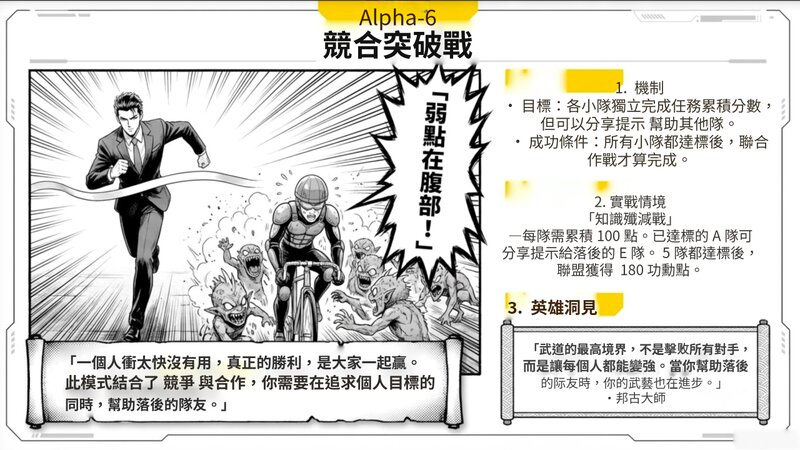

# NBLM2PPTX - Convertisseur PDF NotebookLM vers PPTX

[](https://opensource.org/licenses/MIT)
[](https://github.com/laihenyi/NBLM2PPTX/stargazers)
[](https://github.com/laihenyi/NBLM2PPTX/network/members)
[](https://github.com/laihenyi/NBLM2PPTX/issues)

Convertissez les PDF exportés de NotebookLM en présentations PPTX avec **images d'arrière-plan et couches de texte éditables séparées**.

> ✨ **Mise à jour (2026-10-21)** : application native macOS (n2p-rs) v0.1.1 — conversion de PDF en PPTX modifiable sur votre Mac, sans clé d’API, notarisée par Apple. Voir « Application native macOS » ci-dessous.

[English](README.md) | [繁體中文](README-zh-TW.md) | [简体中文](README-zh-CN.md) | [日本語](README-ja.md) | [Español](README-es.md)

## Application native macOS (hors ligne, Rust)

[`n2p-rs/`](n2p-rs/) est une version native qui s’exécute entièrement sur votre Mac : aucune clé d’API, aucun fichier envoyé.

- **Téléchargement** : [page de la version](https://github.com/laihenyi/NBLM2PPTX/releases/tag/n2p-rs-v0.1.1) (`NotebookLM2PPT-notarized.zip`)
- **OCR** : Vision intégré à macOS (sur l’appareil)
- **Suppression du texte** : seuls les traits du texte sont effacés ; les arrière-plans texturés sont reconstruits par LaMa sur le GPU (CoreML)
- **Extraction d’objets (expérimental)** : les icônes et illustrations deviennent des images déplaçables (MobileSAM)
- **Application** : interface glisser-déposer, signée avec un Developer ID et notarisée par Apple ; les modèles (~253 Mo) sont téléchargés au premier lancement
- **Configuration requise** : Apple Silicon ; macOS 12 ou ultérieur pour l’inférence sur GPU

Compilation, utilisation en ligne de commande et notes de conception : [`n2p-rs/README.md`](n2p-rs/README.md). Licences tierces : [`n2p-rs/THIRD-PARTY.md`](n2p-rs/THIRD-PARTY.md).

### Avant / après (version standard)

| Original (PDF NotebookLM) | Résultat (PPTX modifiable, application macOS) |
|:---:|:---:|
|  |  |
|  |  |

> Le texte devient des zones de texte modifiables ; les illustrations restent en arrière-plan et le filigrane NotebookLM est supprimé (rendu avec LibreOffice).
> Limites actuelles visibles ici : les couleurs de surlignage ne sont pas conservées, le gras est parfois perdu et l’OCR peut mal lire quelques caractères.

### v0.1.1 (2026-10-21)

- **Version avec objets environ 2 fois plus rapide, pic mémoire de ~6 Go à ~1,9 Go** : SAM s’exécute désormais uniquement sur le CPU (présentation de 11 pages : 47–86 s, contre 103–183 s)
- Le texte sur plusieurs lignes est aligné à gauche lorsque l’original l’est (il était toujours centré)
- Dilatation des masques plus rapide pour l’extraction d’objets
- Interface : la section des modèles indique si la version GPU de LaMa est prête
- Outils de développement : la vérification de compatibilité PowerPoint ne lit et ne ferme que la présentation qu’elle a elle-même ouverte

### v0.1.0 (2026-10-21)

- Première version : application glisser-déposer, signée et notarisée
- Vitesse (Apple Silicon, présentation de 11 pages) : version standard 29–45 s (~1,1–1,4 Go), version avec objets 103–183 s (~6 Go)

## Version web assistée par Gemini (plus mise à jour)

> ⚠️ Tout ce qui suit décrit la version web assistée par Gemini (`index.html`). Elle **n’est plus mise à jour** ; les nouveautés sont développées dans l’application native macOS ci-dessus.

## Démonstration

### v1.1 - Extraction de Texte Hybride

| Original (NotebookLM PDF) | Sortie (PPTX Éditable) |
|:-------------------------:|:----------------------:|
|  |  |

> L'extraction native de texte PDF.js fournit un positionnement précis du texte sans appels API supplémentaires.

### v1.0 - Suppression de Texte par IA

| Avant (NotebookLM PDF) | Après (PPTX Éditable) |
|:----------------------:|:---------------------:|
|  |  |

> Gauche : PDF original de NotebookLM (texte intégré dans l'image)
> Droite : PPTX converti avec arrière-plan propre + couches de texte éditables

## Nouveautés de v2.3 (2026-01-21)

### ⚡ Système OCR à Mode Dual
- **Modèle Lite (Par défaut)** : Utilise `gemini-2.5-flash-lite` pour l'OCR, 40-50% plus rapide avec 50% d'économie de quota API
- **Modèle Standard (Optionnel)** : Utilise `gemini-2.5-flash` pour une détection complète de la taille de police, du poids et du style de couleur
- **Flexibilité de l'Utilisateur** : Changez les modèles OCR lors de la sélection des pages pour équilibrer vitesse et qualité selon vos besoins

### 🚀 Technologie de Traitement Parallèle
- **Exécution Simultanée** : La suppression de texte et l'OCR s'exécutent simultanément, sans attente
- **Temps de Traitement Réduit** : De 3-4 secondes par page à 2-3 secondes
- **Tolérance Intelligente aux Pannes** : L'échec d'une seule API n'affecte pas le flux général, améliorant la stabilité

### 💡 Directives d'Utilisation Claires
- **Modèle Lite Optimal Pour** : Notes de texte brut, procès-verbaux de réunion, ébauches de contenu (lorsque le formatage visuel n'a pas d'importance)
- **Modèle Standard Optimal Pour** : Belles présentations, vitrines de marque, diapositives pédagogiques (nécessitent une hiérarchie visuelle)
- **Limitations Transparentes** : Communication claire sur l'incapacité du modèle Lite à détecter les styles de police

### 📊 Comparaison des Résultats

| Modèle Lite | Modèle Standard |
|:--------:|:--------:|
|  |  |

> **Modèle Lite** : Tout le texte utilise un style uniforme, sans variation de taille de police (plus rapide, économise le quota d'API)
> **Modèle Standard** : Préserve complètement la hiérarchie de taille de police entre les titres et le texte du corps (détection complète des styles)

---

## Nouveautés de v2.2.1 (2026-01-21)

### 🌍 Refonte Complète de l'i18n
- **Design Professionnel pour Toutes les Langues** : Refonte complète de toutes les versions linguistiques (anglais, espagnol, japonais, français, chinois simplifié) du thème sombre au thème clair moderne
- **Système de Polices Unifié** : Migration vers Poppins (titres) + Open Sans (corps) avec polices de secours spécifiques à la langue (Noto Sans JP, Noto Sans SC, etc.)
- **Schéma de Couleurs Bleu Professionnel** : Implémentation d'une couleur primaire #3B82F6 cohérente dans toutes les versions pour la confiance et le professionnalisme
- **Modal de Clé API Amélioré** : Stockage de clé API basé sur le navigateur avec intégration localStorage élimine le besoin d'éditer le code
- **Éléments UI Repliables** : Bannière d'alerte et section d'outils repliables pour une interface plus propre

### 📚 Documentation Standardisée
- **READMEs Complets** : Tous les fichiers README linguistiques suivent désormais une structure complète de 204 lignes
- **Guide de Démarrage Rapide** : Instructions de démarrage rapide en 3 étapes ajoutées pour une meilleure intégration
- **Détails du Quota API Gratuit** : Documentation claire du niveau gratuit de Google Gemini (15 RPM, 1500 RPD, aucune carte de crédit)
- **Section FAQ Complète** : 5 paires de Q&R couvrant les questions courantes sur les clés API, la sécurité, les échecs, le partage et l'utilisation hors ligne

### 🎨 Mises à Jour du Système de Design
- **Thème Clair** : Arrière-plan #F8FAFC pour une meilleure lisibilité
- **Mise en Page de Cartes Moderne** : Bordures nettes (#E2E8F0) et ombres subtiles
- **Icônes SVG Professionnelles** : Icônes emoji remplacées par des graphiques SVG appropriés
- **Typographie Responsive** : Tailles de police et espacement optimisés pour toutes les tailles d'écran

---

## Nouveautés de v2.2 (2026-01-20)

### 🎯 Réinitialisation Douce avec Persistance de Clé API
- **Plus Besoin de Ressaisir**: La clé API est conservée en mémoire lorsque vous cliquez sur "Redémarrer"
- **Redémarrages Illimités**: Traitez plusieurs lots sans ressaisir vos identifiants
- **Gestion Intelligente de l'État**: Réinitialise tout l'état de traitement tout en conservant votre clé API

### ⚡ Optimisation de la Vitesse
- **70% Plus Rapide**: Délai entre pages réduit de 3,5s à 1,0s
- **Traitement Parallèle**: Exploite les appels API simultanés pour une efficacité maximale
- **Réinitialisation Instantanée**: La réinitialisation douce revient immédiatement à l'état initial sans rechargement de page

### 🔧 Correction d'Erreur IMAGE_RECITATION
- **Prompt IA Amélioré**: Ingénierie de prompts optimisée pour éviter la détection de droits d'auteur
- **Meilleure Reconstruction d'Arrière-plan**: Résultats plus précis du remplissage conscient du contenu
- **Température Réduite**: Comportement IA plus cohérent avec température 0,4

### 📝 Améliorations de l'UI
- **Instructions Plus Claires**: Guide de configuration de clé API mis à jour pour correspondre au flux réel
- **UI de Réinitialisation Propre**: Interface de téléchargement initial restaurée lors de la réinitialisation au lieu du spinner de chargement

## Fonctionnalités

- **Suppression de Texte par IA** : Utilise Gemini 2.5 Flash pour supprimer automatiquement le texte des images et reconstruire les arrière-plans
- **Extraction de Texte Hybride** : Les sources PDF utilisent l'extraction native PDF.js pour des coordonnées précises ; les sources d'images utilisent Gemini OCR amélioré
- **Couches Séparées** : Le PPTX exporté contient les images d'arrière-plan et le texte comme couches indépendantes pour faciliter l'édition
- **Traitement par Lots** : Prend en charge le traitement de plusieurs pages PDF ou images à la fois
- **Sélection de Pages** : Sélectionnez librement les pages à traiter, économisant temps et quota API

## Utilisation

### Démarrage Rapide (3 Étapes Simples)

1. **Ouvrez le fichier HTML** dans votre navigateur (Chrome/Edge recommandé)
2. **Suivez la configuration guidée** pour obtenir votre clé API gratuite de Google
3. **Commencez à traiter** vos PDF ou images immédiatement !

### Configuration Initiale

Lorsque vous ouvrez l'application pour la première fois, un assistant de configuration convivial vous guidera à travers :

1. **Visitez Google AI Studio** - Lien direct vers [aistudio.google.com/apikey](https://aistudio.google.com/apikey)
2. **Créez votre Clé API Gratuite** - Connectez-vous avec votre compte Google (aucune carte de crédit requise)
3. **Collez et Sauvegardez** - Copiez votre clé API et collez-la dans l'application

> 🔒 **Votre clé API est stockée en toute sécurité dans votre navigateur** et n'est jamais téléchargée sur aucun serveur.

### Quota API Gratuit

L'API Google Gemini offre un niveau gratuit généreux :
- **15 requêtes par minute**
- **1 500 requêtes par jour**
- **Aucune carte de crédit requise**

C'est largement suffisant pour une utilisation quotidienne typique !

### Alternative : Utilisation dans Google Gemini Canvas (Avancé)

Si vous préférez exécuter dans l'environnement Gemini Canvas :

1. Ouvrez [Google Gemini](https://gemini.google.com/)
2. Collez le code de `index-fr.html` dans Canvas
3. Cliquez sur "Preview" pour exécuter

> ⚠️ **Note** : Depuis janvier 2026, une clé API est toujours requise même dans l'environnement Canvas. L'application vous invitera à la configurer.

## Flux de Travail

```
┌─────────────┐    ┌─────────────┐    ┌─────────────┐    ┌─────────────┐
│Télécharger  │ -> │ Sélectionner│ -> │ Traitement  │ -> │Exporter PPTX│
│ PDF/Images  │    │   Pages     │    │IA Suppr.Text│    │ Fond+Texte  │
└─────────────┘    └─────────────┘    └─────────────┘    └─────────────┘
```

### Étape 1 : Télécharger les Fichiers
- Glissez-déposez ou cliquez pour télécharger les PDF exportés de NotebookLM
- Prend également en charge les formats d'image JPG, PNG, WebP
- Plusieurs fichiers peuvent être téléchargés à la fois

> **Conseil** : Les PDF exportés de NotebookLM peuvent être assez volumineux. Vous pouvez utiliser des services gratuits de compression PDF pour réduire la taille du fichier avant de télécharger, ce qui améliorera considérablement l'efficacité.

### Étape 2 : Sélectionner les Pages
- Le système génère automatiquement des miniatures pour toutes les pages
- Cochez les pages que vous souhaitez traiter (toutes sélectionnées par défaut)
- Cliquez sur "Démarrer le Traitement" pour continuer

### Étape 3 : Traitement IA
- Gemini supprime le texte de chaque page et reconstruit l'arrière-plan
- La progression est affichée en temps réel
- Chaque page prend environ 3-5 secondes (y compris la latence API)

> **Note** : La suppression de texte par Gemini peut parfois être incomplète. Si vous remarquez trop de texte résiduel, vous pouvez réessayer le traitement.

### Étape 4 : Exporter PPTX
- Sélectionnez le ratio de présentation (16:9 / 9:16 / 4:3)
- Cliquez sur "Exporter PPTX" pour télécharger
- Le positionnement du texte utilise une stratégie hybride :
  - **Sources PDF** : Utilise les coordonnées pré-extraites de PDF.js (instantané, sans appel API)
  - **Sources d'images** : Utilise Gemini OCR avec détection de style améliorée

## Structure de Sortie

Chaque diapositive du PPTX exporté contient :

| Couche | Contenu |
|--------|---------|
| Inférieure | Image d'arrière-plan propre avec texte supprimé |
| Supérieure | Zones de texte éditables (positionnées selon le texte original) |

Cette structure en couches vous permet de :
- Modifier facilement le contenu du texte
- Changer les polices, couleurs et tailles
- Ajuster les positions du texte
- Préserver le style de design original

## Spécifications Techniques

| Élément | Description |
|---------|-------------|
| Modèle IA | Gemini 2.5 Flash Image (Suppression de Texte) + Gemini 2.5 Flash (OCR) |
| Suppression de Texte | Prompt optimisé pour suppression complète avec inpainting |
| Analyse PDF | PDF.js 3.11.174 |
| Génération PPTX | PptxGenJS 3.12.0 |
| Résolution de Rendu | Miniature 0.5x / Traitement 2.0x |
| Formats Supportés | PDF, JPG, PNG, WebP, BMP |
| Extraction de Texte | Hybride : PDF.js natif (PDF) / Gemini OCR (Images) |

## Notes

1. **Quota API** : La suppression de texte utilise l'API Gemini ; l'extraction de texte PDF est un traitement local (sans coût API)
2. **Limite de Débit** : Le système attend automatiquement et réessaie sur les erreurs 429
3. **Temps de Traitement** : Pour de grandes quantités de pages, envisagez le traitement par lots
4. **Réseau** : Nécessite une connexion internet stable
5. **Navigateur** : Chrome ou Edge (dernière version) recommandé
6. **Avantage PDF** : Les sources PDF s'exportent plus rapidement avec un positionnement de texte plus précis

## FAQ

### Q : Ai-je besoin d'une carte de crédit pour obtenir la clé API ?
R : Non ! L'API Google Gemini offre un niveau entièrement gratuit sans carte de crédit requise. Connectez-vous simplement avec votre compte Google.

### Q : Ma clé API est-elle sécurisée ?
R : Oui ! Votre clé API est stockée uniquement dans le localStorage de votre navigateur et n'est jamais envoyée à aucun serveur sauf l'API officielle Gemini de Google.

### Q : Que faire si le traitement échoue ?
R : Causes courantes :
- Clé API invalide (vérifiez qu'elle commence par "AIza")
- Connexion réseau instable
- Image trop grande ou format non supporté
- Limite de débit API dépassée (niveau gratuit : 15/min, 1500/jour - attendez et réessayez)

### Q : Puis-je partager cet outil avec d'autres ?
R : Absolument ! Partagez simplement le fichier HTML. Chaque utilisateur configurera sa propre clé API, donc tout le monde obtient son propre quota gratuit.

### Q : Peut-on l'utiliser hors ligne ?
R : Non, cet outil nécessite des appels à l'API Gemini pour le traitement IA.

## Versions Linguistiques

| Langue | Fichier |
|--------|---------|
| 繁體中文 | `index.html` |
| English | `index-en.html` |
| Español | `index-es.html` |
| 日本語 | `index-ja.html` |
| Français | `index-fr.html` |
| 简体中文 | `index-zh-CN.html` |

## Licence

MIT License
